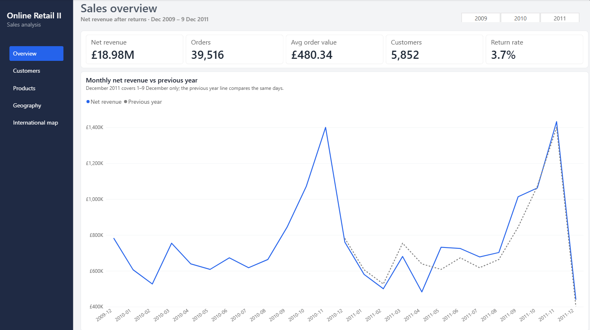
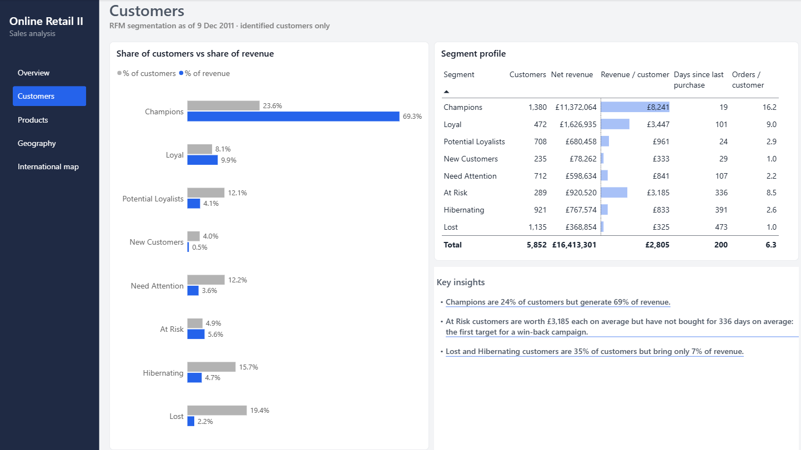
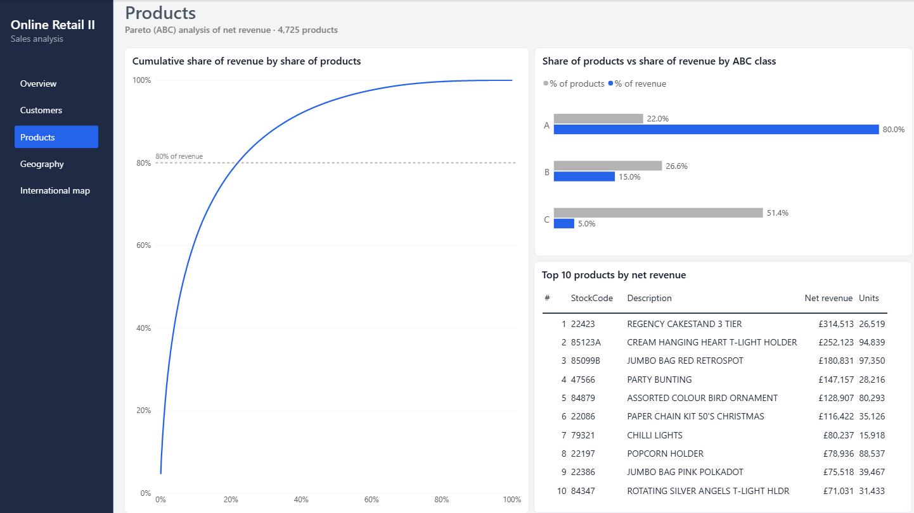
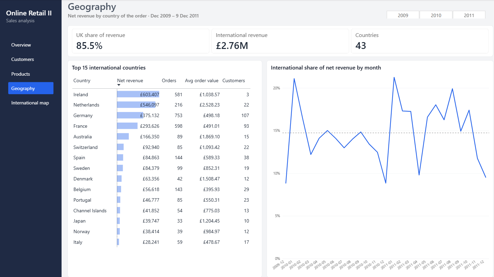
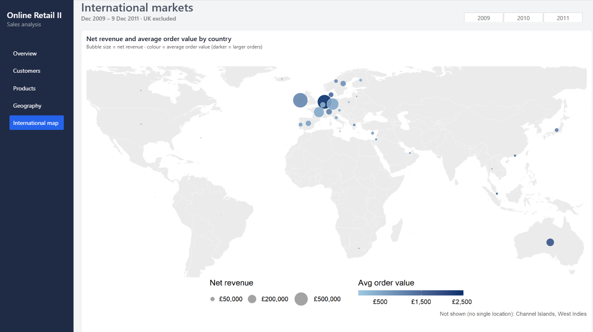
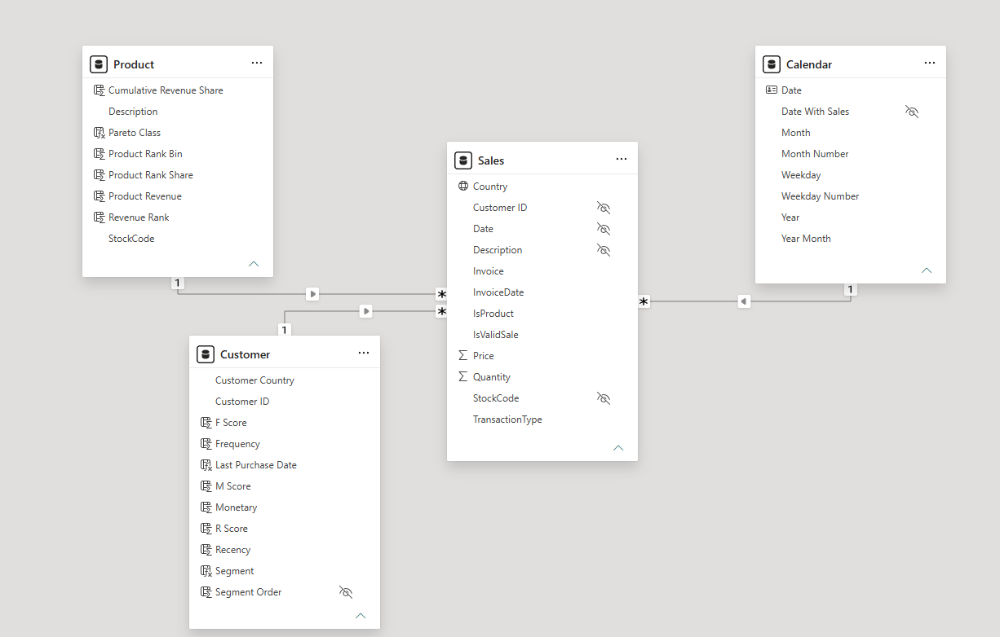

# Online Retail II: sales analysis in Power BI

Sales dashboard for a UK-based online retailer of giftware, built in Power BI on two years of real transactions: about one million invoice lines from December 2009 to 9 December 2011.

The report covers sales trends, customer segmentation (RFM), product concentration (Pareto / ABC) and international markets. Most of the work went into checking and cleaning the data: several of the numbers a quick analysis would report turn out to be wrong.



## Key findings

- **Net revenue of £18.98M** after returns, from 39,516 orders and 5,852 identified customers. Returns are 3.7% of gross sales.
- **2011 grew 2.5% on 2010** in comparable periods. A naive comparison gives +0.9% (2011 ends on 9 December), and a comparison of gross sales gives +5.0% (it ignores returns). See [How the growth figure changed](#how-the-growth-figure-changed).
- **Customers are highly concentrated.** Champions are 24% of customers and 69% of revenue. Lost and Hibernating customers are 35% of customers and 7% of revenue.
- **At Risk customers are the clearest opportunity:** 289 customers worth £3,185 each on average, who have not bought for 336 days on average.
- **22% of products generate 80% of revenue**, while half of the catalogue (class C) brings 5%.
- **The UK is 85.5% of revenue.** Abroad there are two kinds of market: many small customers (Germany, France) and a few large buyers (Ireland: £603K from 3 customers; the Netherlands: average order of £2,528, five times the overall average).

## Report pages

| Page | Content |
|---|---|
| **Overview** | KPI cards and monthly net revenue against the same period of the previous year |
| **Customers** | RFM segments: share of customers vs share of revenue, segment profile and key insights generated with DAX |
| **Products** | Pareto curve, ABC classes and top 10 products |
| **Geography** | UK share, top 15 international countries and the international share of revenue by month |
| **International map** | Bubble map made with an R visual (ggplot2): net revenue and average order value by country |

<details>
<summary><b>More screenshots</b></summary>






</details>

## Data preparation (Power Query)

The source file has two sheets, one per year. Each step below is a named step in the Power Query code (`online_retail.SemanticModel/definition/tables/Sales.tmdl`).

| Step | Rows | Why |
|---|---|---|
| Both sheets | 1,067,371 | |
| Remove the week in both sheets (1–9 Dec 2010) | −22,523 → 1,044,848 | The same rows appear in the two sheets |
| Flag cancellations (invoice starting with `C`) | 19,165 | Kept, to measure returns |
| Flag non-product codes | 5,813 | Postage, bank charges, discounts, manual entries, gift vouchers, test codes |
| Flag valid sales: sale + product + price > 0 | **1,015,088** | Rows with price 0 are stock movements (damaged, missing, found…) with no customer |

Rows are flagged rather than deleted, so each measure decides which rows it uses.

Other checks and decisions:

- **Non-product codes** are an explicit list, not a pattern. A first rule (codes starting with five digits) wrongly excluded real web-shop products (`DCGS…`).
- **Stock codes are converted to upper case.** Power Query is case-sensitive but the model is not, so `72349B` and `72349b` broke the product relationship. 164 codes were merged.
- **One description per product:** the most recent one, since some products were renamed during the period.
- **Country** of the customer: the country of their latest purchase. `EIRE` and `RSA` are renamed to Ireland and South Africa.
- **Two keyed-in errors** were found among the largest lines: orders of 80,995 and 74,215 units (£168K and £77K) cancelled within 20 minutes. They are why returns must be netted off revenue.

## Data model

Star schema with one fact table (`Sales`, one row per invoice line) and three dimensions. All relationships are one-to-many with single-direction filtering.



- `Calendar` is a DAX table with whole years and a `Date With Sales` flag used by the time-intelligence measures.
- 13.5% of net revenue has no customer ID. It counts in every sales figure but not in the customer analysis.
- Model checks are saved as DAX queries in `online_retail.SemanticModel/DAXQueries/`: no valid sale lacks a product, customer or date, and the measures by year and the RFM and Pareto results can be re-run at any time.

## DAX

Measures are grouped in display folders: Sales, Time intelligence, Customers, Products, Geography and Insights.

- **Net revenue** = gross revenue − returns. The sales filter lives inside each base measure, so no visual can bypass it.
- **Previous year** compares only periods that have data in both years. 2011 is compared with 1 Jan–9 Dec 2010, and no comparison is shown when the previous period starts before the data does.
- **RFM** is computed as calculated columns on `Customer` (a snapshot at 9 Dec 2011). Recency and monetary scores are quintiles with `RANKX`; frequency uses fixed thresholds (1, 2, 3–4, 5–9, 10+ orders) because 28% of customers have a single order and quintiles cannot split ties. Segments use recency and frequency: the average monetary score rises from 1.5 to 4.8 across frequency scores, so monetary value is used to size the segments rather than to define them.
- **Pareto** cumulative share is a calculated column (computed once at refresh). The curve is plotted in bins of 0.1% of the catalogue to avoid Power BI's automatic sampling of 4,725 points.
- **Key insights** on the Customers page are DAX text measures, so the sentences update with the data.

### How the growth figure changed

| Comparison | 2011 vs 2010 |
|---|---|
| Full years, gross sales | +0.9% |
| Same period (to 9 December), gross sales | +5.0% |
| Same period, net of returns | **+2.5%** |

## Run it

Requires Power BI Desktop (no Power BI account needed).

1. Download [Online Retail II](https://doi.org/10.24432/C5CG6D) and save it as `data/online_retail_II.xlsx`.
2. Open `online_retail.pbip`. If the data does not load, go to **Transform data**, select the `Year 2009-2010` and `Year 2010-2011` queries and update the file path in their **Source** step.
3. The **International map** page is an R visual. It needs R and the packages `ggplot2`, `dplyr`, `sf`, `rnaturalearth`, `rnaturalearthdata`, `countrycode` and `scales`. The rest of the report works without R.

## Project structure

```
online_retail.pbip                  open this file in Power BI Desktop
online_retail.SemanticModel/        data model: Power Query, tables, relationships, measures (TMDL)
  DAXQueries/                       model checks
online_retail.Report/               report pages and visuals (PBIR)
theme/online-retail-theme.json      report theme
docs/screenshots/                   images for this README
data/                               source file (not included)
```

The project is saved in Power BI Project format, so the model, the Power Query code and the report are plain-text files that can be reviewed and versioned with Git.

## Tools

Power BI Desktop · Power Query (M) · DAX · R (ggplot2, sf) · Git

## Data

Chen, D. (2012). *Online Retail II* [Dataset]. UCI Machine Learning Repository. https://doi.org/10.24432/C5CG6D. Licensed under CC BY 4.0.

## Author

Borja Lafuente Rego — [LinkedIn](https://www.linkedin.com/in/borjalafuenterego/)
